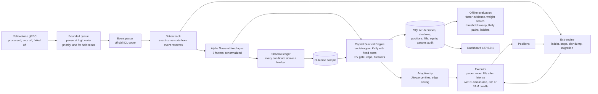

# CurveAlpha V5

**A capital survival and selectivity engine for pump.fun bonding curves, built for bankrolls of 0.5 to 5 SOL.**

CurveAlpha is not a sniper. Its job is to refuse almost every trade. It models the bonding curve and its fees with the program's own integer arithmetic, scores each new token on seven independent kinds of evidence, learns the real distribution of outcomes from a counterfactual ledger of every candidate it sees, and sizes the rare trade it does take with fractional Kelly under that heavy tailed distribution, with the fixed transaction costs inside the math. Paper trading is the default and uses the identical pipeline against live data.

---

## Read this first

**This software can lose all of the SOL you give it. Most pump.fun tokens go to zero, most participants lose money, and the measured edge of any strategy, including this one, can disappear without warning.** Insiders, bundlers and professional latency operators are on the other side of every trade. Nothing here is financial advice, nothing here is a promise of profit, and past results in paper mode do not predict live results.

The build environment that produced this code had no access to Solana mainnet, Jito or any gRPC provider. Everything that can be proven offline has been proven (see [What is proven](#what-is-proven)). The live execution path (bundle submission, landing, fill reconciliation) is implemented against the documented APIs and the official SDK but has **not** been exercised on mainnet. Run paper mode for days, then run live with the smallest bankroll you are willing to lose entirely, and watch it.

Only ever fund the trading wallet with the trading bankroll. Keep everything else elsewhere.

---

## What building it found

The specification this was built from was precise, and checking it against pump.fun's own code changed several details. These are reflected in the code:

| The spec said | What is true (October 2026) | What CurveAlpha does |
|---|---|---|
| Fees are a flat 1.25 % | Fees come from a **market cap tier table** in the pump-fees `FeeConfig` account, and a coin may carry its own creator rate. The curve rate is publicly reported at 0.95 % protocol + 0.30 % creator, and a curve never leaves one tier before graduating (market cap runs from about 28 SOL to about 411 SOL). | Reads `Global` and `FeeConfig` from chain at startup and every 5 minutes. Refuses to start if it cannot. Never trades on an assumed fee. |
| One buy formula | The formula in the spec is the v1/v2 `buy_exact_sol_in` path. The v3 path (`buy_exact_quote_in_v3`) computes fees separately per component, ceils each, and buys with `net - 1`. They give different token amounts. | Implements both, plus the v3 crossing buy that completes the curve and continues into the pool to be. Trades through v3. |
| Graduation at about 85 SOL | Exactly **85.005359057 SOL** of net inflow from the initial state; price rises 14.696x along the way. | Computes it per curve, exactly. |
| Atomic entry plus partial take profit in one bundle "when the mathematics support it" | Inside one atomic bundle nobody else can trade between the buy and the sell, so the sell always returns less than the buy cost. A test proves it on thousands of random states. | Not built, because it can never be positive EV. |
| A sell returns its quoted SOL | On dust amounts the separately ceiled fees can exceed the gross output; the official SDK returns a negative number. | Treats any result at or below zero as unsellable; worthless remainders are burned and the account closed to recover its rent. |
| BAM Direct Bundle Ingest removes ~50 ms | True, but it is whitelist only, and Jito puts BAM nodes into maintenance around Alpenglow activation (scheduled 21 October 2026). | BAM is used only when configured and enabled; the Block Engine is always the fallback. |
| Local keypair or hardware wallet | A hardware wallet needs a button press per signature, which cannot meet a sub-second entry. | Signs with a local hot keypair holding only the bankroll; keep savings on the hardware wallet. |
| Size from fractional Kelly | Textbook Kelly ignores fixed costs. At 0.5 SOL, a few hundred thousand lamports of tips are a large share of a 1.25 % stake. | Fixed costs are inside the Kelly objective, so a trade must beat **not trading**, not merely have positive expectation. |

---

## Philosophy: survival and selectivity over speed

Small capital cannot win a latency race against co-located bots, and it cannot absorb a string of ruinous losses. What it can do is:

1. **Refuse.** The default answer to every candidate is no. A trade is approved only if every gate passes: not halted, under the concurrency limit, alpha above a threshold that rises with drawdown, enough comparable evidence, a Kelly stake that beats not trading after all costs, every risk cap, and a conservative lower bound of expected value that clears a required edge.
2. **Measure exactly.** Every curve quantity that feeds a decision is computed with integer arithmetic identical to the program. Exit triggers use the exact lamports a sell would return now, after fees and price impact, not a float price.
3. **Learn from the market, not from its own trades.** Every token that scores above a low bar gets a *shadow position*: a nominal buy filled exactly against the live curve after realistic latency, managed by the same exit engine, recorded when it closes. The Survival Engine sizes from these outcomes. This removes the selection bias of learning only from trades actually taken and builds evidence at the full rate of the market while paper trading.
4. **Distrust the tail.** Pump.fun returns are extremely skewed: a single 40x outlier can dominate a sample. Outcomes are winsorized at a cap, every estimate is bootstrapped, and the engine uses a low quantile (25th percentile Kelly stake, 20th percentile EV) rather than the point estimate.
5. **Stop when wrong.** A daily loss breaker halts trading for 24 hours. Drawdown from peak moves the engine through CAUTION and SURVIVAL modes, which raise the alpha threshold and shrink position sizes. A bankroll floor halts trading until the operator reviews it. Breaker state survives restarts.

---

## Architecture



| Module | Responsibility |
|---|---|
| `src/math/curve.ts` | Exact curve arithmetic (v1/v2, v3, crossing buys, fee tiers, state transitions). |
| `crates/curve-core` | The same arithmetic in Rust (u128, no dependencies), checked against SDK generated vectors. |
| `src/chain/*` | Account reads, IDL decoding adapters, event parsing (self CPI and log events). |
| `src/ingest/*` | Yellowstone client with reconnect, `from_slot` replay, ping, dead slot retraction; bounded queue; token book. |
| `src/score/*` | Seven factors, the fusion, and their knowledge stores (creators, ranked wallets, trajectory corpus, funding sources, names, X counts). |
| `src/risk/*` | Exact fixed cost model, Kelly and bootstrap, Capital Survival Engine, viability table. |
| `src/exits/exitEngine.ts` | All exit triggers on exact liquidation value. |
| `src/exec/*` | Transaction construction, compute measurement, Jito/BAM bundles, adaptive tips, paper and live executors, positions. |
| `src/meta/*` | Shadow ledger, offline evaluation, decision replay. |
| `src/store/db.ts` | SQLite persistence through `node:sqlite` (no native build). |
| `src/config/*` | 78 hot reloadable parameters with validation and audit; infrastructure settings. |
| `src/dashboard/*` | Live console. |

---

## Setup

### Requirements

* Node.js 22.13 or newer (uses the built in `node:sqlite`).
* A **Yellowstone gRPC endpoint** (Triton, Helius, Shyft, QuickNode and others sell them). Required even for paper trading, because paper trading runs on the live stream. Run CurveAlpha in the same region as the endpoint.
* A Solana **RPC endpoint**. The public one is enough for paper mode; live mode requires a private one (simulation and confirmation polling would be rate limited).
* For live mode: a **dedicated keypair** file holding only the trading bankroll.
* Optional: Rust (to run the second implementation's tests), an X API bearer token on a tier that includes the recent counts endpoint, a Jito auth UUID, a BAM whitelist URL.

### Install

```bash
git clone https://github.com/marxsen4you-svg/curvealpha.git
cd curvealpha
npm install
npm test                 # TypeScript suites, including the differential proof against pump.fun's SDK
npm run test:rust        # optional: the Rust implementation against SDK generated vectors
```

### Configure

Create a `.env` file (see `.env.example`):

| Variable | Meaning |
|---|---|
| `CURVEALPHA_MODE` | `paper` (default) or `live`. |
| `CURVEALPHA_GRPC_ENDPOINT` | Yellowstone gRPC URL, for example `https://your-endpoint:443`. |
| `CURVEALPHA_GRPC_TOKEN` | The provider's `x-token`, if it uses one. |
| `CURVEALPHA_RPC_URL` | Solana RPC URL. |
| `CURVEALPHA_PAPER_SOL` | Starting paper bankroll in SOL (default 2). |
| `CURVEALPHA_KEYPAIR` | Live mode: path to a `solana-keygen` JSON keypair (chmod 600). |
| `CURVEALPHA_BLOCK_ENGINE_URL` | Jito Block Engine, default `https://mainnet.block-engine.jito.wtf`. Use the regional URL nearest you (`ny`, `slc`, `amsterdam`, `frankfurt`, `london`, `dublin`, `tokyo`, `singapore`). |
| `CURVEALPHA_BAM_URL` | BAM Direct Bundle Ingest URL, only if whitelisted. Enable with `execution.useBam`. |
| `CURVEALPHA_JITO_UUID` | Jito auth UUID for higher rate limits, if you have one. |
| `CURVEALPHA_X_BEARER` | X API bearer token, optional. |
| `CURVEALPHA_DATA_DIR` | Where the database and `params.json` live (default `data`). |
| `CURVEALPHA_DASHBOARD_PORT` | Dashboard port (default 7420, always bound to 127.0.0.1). |
| `CURVEALPHA_LOG_FORMAT` | `json` for JSON lines; anything else gives timestamped text lines (journald friendly). |

Secrets are read only from the environment and are never stored or shown on the dashboard. Every log line goes through one logger that masks the configured secrets, credentials in URLs (`user:pass@host`) and key-like query parameters (`api-key=`, `x-token=`, ...).

### Run

```bash
node --env-file=.env --import tsx src/cli.ts preflight   # read-only checks; nothing is signed or sent
node --env-file=.env --import tsx src/cli.ts run         # or: npm run build && node --env-file=.env dist/cli.js run
```

`run` performs the same preflight first and refuses to start on any failed check (see [Operations](#operations)).

Open `http://127.0.0.1:7420`. On a remote machine, reach it with `ssh -L 7420:127.0.0.1:7420 yourhost`.

Paper mode needs time before it can trade: the Survival Engine will not size anything until enough comparable shadow outcomes exist (`risk.minOutcomeSamples`, default 60), the trajectory factor needs a corpus (`scoring.trajectoryMinCorpus`, default 200 finished curves), and smart money ranking needs wallet history. Expect the first hours to show refusals with reason `evidence`. That is correct behaviour.

### Going live

Do not switch until all of these are true:

1. Paper mode has run for several days, and `curvealpha evaluate` shows factors with positive rank correlation and a threshold whose log growth per trade is positive.
2. `curvealpha costs` at the current tip floor shows your bankroll's fixed costs are a small share of the stake.
3. You have funded a fresh keypair with only what you can lose.

Then set `CURVEALPHA_MODE=live`, `CURVEALPHA_KEYPAIR`, a private `CURVEALPHA_RPC_URL`, and start with the explicit acknowledgement flag:

```bash
node --env-file=.env --import tsx src/cli.ts run --i-accept-the-risk
```

Live and paper keep separate databases and separate survival state.

---

## Operations

| Need | Command or behaviour |
|---|---|
| Is it safe to start? | `curvealpha preflight`: Node version, settings, database integrity, parameters, the trading key (live), RPC, consensus (TowerBFT or Alpenglow), decoded protocol state, event discriminators against the SDK's IDL, the deployed pump and PumpSwap programs against the versions this build was verified against, a read-only simulation that the program dispatches the v3 buy and sell, and the Jito tip floor. Exit 0 only if nothing failed. |
| The pump program was upgraded | Preflight warns in paper and **fails in live** until you have run the tests and paper mode against it and acknowledged it: `curvealpha preflight --accept-program-upgrade` (recorded in the decision log). |
| Is it healthy? | `curvealpha status` (exit 0 ok, 1 degraded, 2 down) or `GET /api/health` on the dashboard. Degraded means one of: feed disconnected or silent over 30 s, trading halted, open positions without a readable curve, failed database writes, a stale tip floor (entries refused), event loop p99 over 200 ms. Down means no heartbeat for 15 s. Each problem is logged once as `ALERT` when it appears and once when it clears. |
| Stop | `SIGINT` or `SIGTERM` (`systemctl stop curvealpha`): no new entries, then up to 30 s for orders and exits in flight to settle, then state is flushed. |
| Restart | Open positions are restored from the database with their exit state and resume being managed. In live mode each one is checked against the wallet's actual token balance, so a sell that landed but was never recorded is reconciled and a position with nothing left is closed. |
| Back up | `curvealpha backup [file]`: a consistent online copy (`VACUUM INTO`) while the engine runs, integrity-checked. |
| Restore | `curvealpha restore <file>` with the engine stopped. Refuses a corrupt backup or one from a newer schema; the replaced database is kept beside it. |

### Alpenglow (Solana consensus upgrade, mainnet epoch 1064, about 21 October 2026)

Solana lists Alpenglow as a breaking change. After it takes over, a slot can have more than one candidate bank, and a `processed` stream (which CurveAlpha uses for speed) includes transactions from banks the leader later abandons. CurveAlpha keeps each event's bank id and taints every mint with an event in an abandoned bank, exactly as it does for a dead slot, so phantom trades never reach scoring. That needs a Yellowstone provider whose server sends bank ids (Yellowstone v16 for Agave 4.3); ask yours before running live after the switch. Do not hold live positions across the switch itself, and run `curvealpha preflight` afterwards: its `consensus` line says which consensus the cluster is on. Source: [solana.com/upgrades/alpenglow](https://solana.com/upgrades/alpenglow) (read 19 October 2026).

---

## How one decision is made

1. **Detection.** A `CreateEvent` creates a token record. Every `TradeEvent` replaces the curve state with the reserves the program reported after that trade, so no reconstruction error can accumulate.
2. **Scoring at fixed ages** (15, 30, 60, 90 s by default). Vetoes first: non SOL quote, mayhem or cashback coins, a dropped or forked away event for this mint, a completed curve, over 90 % sold, or a creator who has sold half or more. Then seven factors, each in [0, 1] or *unavailable*:
   * **Creator**: graduation rate of prior launches shrunk toward a 1 % base rate, serial launcher and fast dumper penalties, and any selling in this token.
   * **Microstructure**: share of the first buys landing in the creation slot, share of first buyers whose whole balance was about the size of their buy (freshly funded), and funding source concentration resolved in the background over RPC.
   * **Holders**: breadth of unique buyers, wash round trips, top 10 concentration, dispersion of buy sizes (sybil swarms buy alike).
   * **Velocity**: net SOL inflow rate, its acceleration, buy and sell imbalance, projected time to graduation.
   * **Smart money**: overlap of early buyers with wallets ranked by realized P&L observed by the engine itself.
   * **Social**: X mention velocity and acceleration for the mint address when an X token is configured, and name novelty against recent launches (copycats score low).
   * **Trajectory**: k nearest neighbours among finished curves by inflow path, compared to the base rate of reaching 2x.
   Unavailable factors are dropped and weights renormalized. If less than half the weight is available the token is not scored. Scoring has a hard deadline (350 ms by default); a late score is discarded.
3. **Shadow.** Score at or above `scoring.shadowMinScore` opens a shadow position.
4. **Survival Engine.** Score at or above the dynamic threshold builds a candidate: the comparable closed shadow outcomes (same horizon, score within 7.5 points, last 14 days), the exact fixed costs at the current tip percentiles, the ATA rent, and the spendable balance. The engine returns approve or refuse with every intermediate number.
5. **Tip check.** The market tip at the configured percentile must fit inside 60 % (configurable 50 to 70 %) of the residual edge.
6. **Execution.** The exact quote sets the minimum tokens out. Live: the instructions (idempotent ATA create, `buy_exact_quote_in_v3`, tip transfer) are simulated at 1.4 M CU, the limit is set to measured plus 12 %, the transaction is sent as a bundle, confirmation is polled, and the real SOL and token deltas are read back from the confirmed transaction. Paper: the same order fills after the configured latency against the curve state at that moment, and every fixed cost is charged.
7. **Exits** run on every trade for the mint and every second: creator dump (emergency, higher tip), migration (sell on PumpSwap through the official SDK, or hold), hard stop, maximum hold, trailing stop after the first rung, momentum decay before it, and the take profit ladder (30 % at 1.6x, 30 % at 2.5x, 20 % at 4x, 10 % at 8x, a 10 % runner). The final sell closes the token account and recovers its rent.

---

## What is proven

| Claim | Evidence |
|---|---|
| Curve math equals the program's reference arithmetic | `test/curve.diff.test.ts` compares every function against `@pump-fun/pump-sdk` 4.1.0 on randomized curve states, fee tables (random and the real mainnet PumpSwap table), creator flags, mayhem supplies and crossing buys. Run with `CURVE_DIFF_CASES=60000` it is over a million comparisons with zero mismatches. |
| A second, independent implementation agrees | `crates/curve-core` (Rust, u128) passes 14 000 vectors whose expected values were produced by the official SDK, not by CurveAlpha (`npm run vectors` regenerates them). |
| Curve invariants | k never decreases through a buy or a sell, output is monotone in input, the v3 simulation never exceeds its budget, and an immediate round trip always loses. |
| Survival Engine behaviour | Kelly matches the closed form when fixed costs are zero; fixed costs remove the stake at small bankrolls; negative expectation samples are never approved; caps, breakers, mode transitions, restart persistence and exact replay are all tested. |
| Pipeline | A synthetic market (rugs with bundled freshly funded buyers and creator dumps, fading duds, accelerating runners) is streamed through the real engine; it checks that decisions replay identically, that the paper ledger balances to the lamport, that the risk cap holds on every entry and that scoring stays inside its deadline. |
| Instruction construction | Buy and sell instructions decode back, through the program IDL, to the exact amounts and discriminators. |
| Risk is held for orders in flight | Concurrent entries cannot exceed the position limit or the risk budget while earlier orders are still unconfirmed (`test/risk.reservation.test.ts`). |
| Restarts lose nothing | A crash with an open position, a restart on the same database, and the exits close it; the paper ledger balances to the lamport across the crash (`test/engine.restart.test.ts`). |
| Live fills come from the chain | Fills are read from the confirmed transaction, re-read while the RPC catches up, never assumed; "did not land" is declared only after the blockhash expired (`test/live.reconcile.test.ts`, scripted RPC and block engine, throwaway key, no network). |
| Faults are contained | A thrown buy halts entries, a thrown sell is retried, an unhandled rejection halts and is recorded, a failing database write degrades instead of crashing (`test/engine.faults.test.ts`, `test/store.robustness.test.ts`, `test/faults.process.test.ts`). |
| Ingest never stalls or lies about time | A replay that keeps failing is abandoned after three attempts and the gap recorded; replayed history is never scored; abandoned Alpenglow banks and late events from dead slots taint their mints (`test/ingest.reconnect.test.ts`, `test/ingest.banks.test.ts`). |
| Evaluation has no look-ahead | Kelly paths size each entry only from outcomes closed before it opened; the weight search split is purged; intervals treat the mint as the unit (`test/evaluate.methodology.test.ts`). |
| Operations fail closed | Preflight, health, backup and restore are tested on literal inputs and real databases (`test/ops.*.test.ts`). |

Not proven offline: live landing rates, real tip levels, gRPC provider behaviour (including bank ids after Alpenglow), PumpSwap exits on real pools, and whether any factor predicts real outcomes. Paper mode and `curvealpha evaluate` are how you find that out.

---

## Tuning for 0.5 to 5 SOL

### The arithmetic you are up against

`curvealpha costs --tip <lamports>` prints this table for any tip level (or reads the live Jito floor without `--tip`). It buys the largest stake the default 1.25 % risk cap allows on a curve with 10 SOL raised, and assumes one buy and three sells.

At a 20 000 lamport tip:

| Bankroll | Stake | Fixed costs | Fixed % of stake | Lost to curve fees and impact if sold at once | Price move to break even |
|---|---|---|---|---|---|
| 0.5 | 0.00625 | 0.00010 | 1.61 % | 2.47 % | 1.0421x |
| 1.0 | 0.01250 | 0.00010 | 0.80 % | 2.47 % | 1.0342x |
| 2.0 | 0.02500 | 0.00010 | 0.40 % | 2.47 % | 1.0307x |
| 5.0 | 0.06250 | 0.00010 | 0.16 % | 2.47 % | 1.0302x |

At a 200 000 lamport tip:

| Bankroll | Stake | Fixed costs | Fixed % of stake | Lost to curve fees and impact if sold at once | Price move to break even |
|---|---|---|---|---|---|
| 0.5 | 0.00625 | 0.00082 | 13.13 % | 2.47 % | 1.1603x |
| 1.0 | 0.01250 | 0.00082 | 6.56 % | 2.47 % | 1.0933x |
| 2.0 | 0.02500 | 0.00082 | 3.28 % | 2.47 % | 1.0603x |
| 5.0 | 0.06250 | 0.00082 | 1.31 % | 2.47 % | 1.0420x |

At a 1 000 000 lamport tip a 0.5 SOL bankroll needs a 1.69x move just to break even. When tips spike, the engine stops trading small bankrolls by itself; that is the system working.

### Recommended settings

| Parameter | 0.5 to 1 SOL | 1 to 3 SOL | 3 to 5 SOL | Why |
|---|---|---|---|---|
| `risk.maxRiskPerTradePct` | 0.0125 to 0.015 | 0.0125 | 0.01 to 0.0125 | At the bottom, fixed costs need the larger stake; at the top, a smaller share is enough. |
| `risk.maxConcurrentPositions` | 1 | 2 | 2 to 3 | Concurrency multiplies tail risk on correlated launches. |
| `risk.kellyFraction` | 0.25 to 0.35 | 0.35 to 0.5 | 0.5 | Fewer samples and higher fixed cost share call for less. Never above 0.5. |
| `risk.minOutcomeSamples` | 100 | 80 | 60 | Fewer trades should mean more evidence each. |
| `scoring.baseAlphaThreshold` | 75 to 80 | 70 to 75 | 70 | Selectivity is the only lever small capital has. |
| `execution.tipPercentile` | `p50` or `ema50` | `ema50` | `ema50` or `p75` | Do not chase the 95th percentile with a 0.006 SOL stake. |
| `execution.exitTipPercentile` | `p75` | `p75` | `p75` | Exits matter more than entries; stops escalate to p95 and p99 automatically. |
| `exits.tpLevels` | `[1.6, 2.5, 4, 8]` | same | same | Recover the stake early; let the runner find the tail. Compare alternatives with `evaluate`. |

Change one thing at a time and let a full day of shadow outcomes accumulate before judging it. Do not lower `risk.minEdgePct`, `risk.evBootstrapQuantile` or `risk.kellyBootstrapQuantile` to make the engine trade more; those are the parts that keep it alive.

All 78 parameters live in `data/params.json`, are validated on every edit (bad edits are rejected and the previous set stays in force), and take effect on the next decision. The dashboard has an editor; `curvealpha check-params` validates the file.

---

## Decision audit methodology

Every decision is reproducible from what is stored.

* **`decisions`** holds one row per sizing decision, exit and execution, with the full payload: the Alpha result (every factor value and its raw measurements), the survival snapshot, the candidate including the exact outcome sample and the bootstrap seed, the parameters in force, the tip floor, the result, and every intermediate sizing number.
* **`curvealpha replay <id>`** re-runs the Capital Survival Engine on a stored decision and reports whether it reaches the identical result. A difference means the code's behaviour changed since the decision was made.
* **`shadows`** holds every counterfactual position with its entry score, factor values, realized multiple, number of sells, close reason and its multiple path at one second resolution.
* **`positions`** and **`fills`** hold every real or paper trade with curve fees, network fees, tips, rent, signatures and bundle ids.
* **`params_audit`** holds every parameter change attempt with source, diff and whether it was accepted.
* **`equity`** and **`tips`** hold the mark to market history and the tip floor history.
* **`curvealpha evaluate`** reports, over the last 14 days: rank correlation of each factor with outcomes and its top and bottom tercile means; a weight search fitted on the older 70 % of outcomes and judged on the newer 30 % (suggested only if the held out result improves; `--apply-weights` applies it through the audited path); a threshold sweep with log growth per trade; sequential Kelly bankroll paths for fractions 0.25, 0.5 and 0.75; ladder alternatives replayed on the recorded shadow paths; and closed position P&L split by each factor's share of the entry score (an accounting convention, not proof of cause).

---

## Commands

| Command | What it does |
|---|---|
| `curvealpha run` | Preflight, then start the engine and dashboard. |
| `curvealpha preflight [--accept-program-upgrade]` | Every start-up check, read-only. Exit 1 on any failure. |
| `curvealpha status` | Health from the running engine's heartbeat, with open positions. Exit 0 ok, 1 degraded, 2 down. |
| `curvealpha backup [file]` | Online, integrity-checked copy of the database (default `data/backups/`). |
| `curvealpha restore <file>` | Put a backup in place (engine stopped; the replaced database is kept). |
| `curvealpha costs [--tip L] [--cu-price M]` | Fixed cost viability table. |
| `curvealpha evaluate [--days N] [--apply-weights]` | Offline evaluation report. |
| `curvealpha replay <id>` | Replay a sizing decision. |
| `curvealpha decisions [--limit N]` | Recent decisions. |
| `curvealpha check-params` | Validate `params.json`. |

## Development

```bash
npm run typecheck
npm test                         # all TypeScript suites (the market simulation takes a few minutes)
CURVE_DIFF_CASES=60000 npx vitest run test/curve.diff.test.ts
npm run vectors && npm run test:rust
npx tsx scripts/bench.ts         # repeatable benchmarks on fixed seeds
```

CI (`.github/workflows/ci.yml`) runs the typecheck, build, the full suite on Node 22.13 and 24, the Rust vectors and a dependency audit that fails on critical advisories, on every push. No test touches a network or a funded key.

## License

MIT. No warranty of any kind; see the risk section above.
